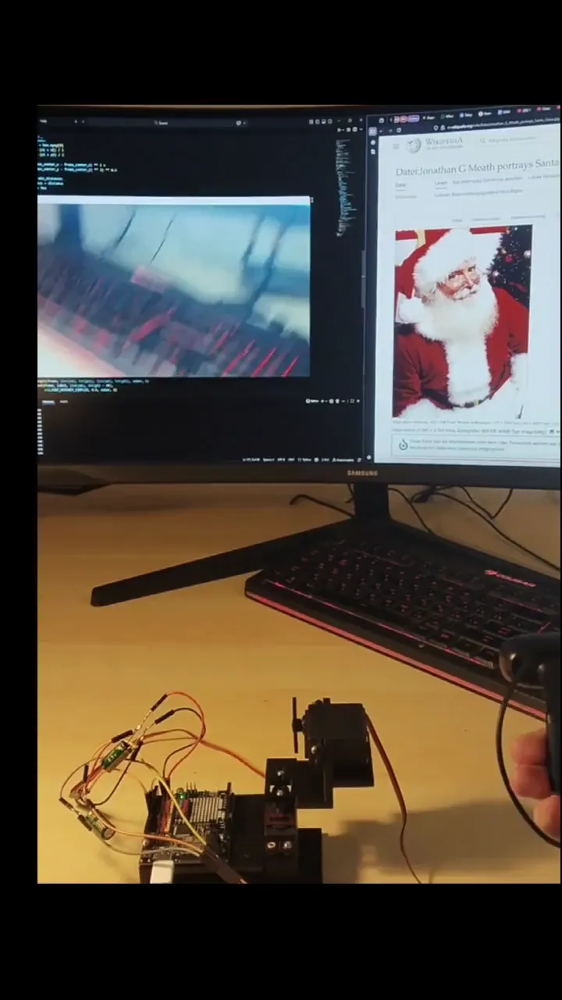

# Real-Time Object Tracking Turret (Work in Progress)
Real-time computer vision system that searches target classes (Santas) using ultralytics, if found, calculates and gives instructions for aiming to Arduino, that controls a dual-axis servo turret.

## Preview (a little bit outdated):


## Tech Stack

- **Python** — Core application language.
- **C++** — Arduino's language.
- **OpenCV** — Video capture and visualization.
- **Ultralytics (YOLO26)** — Object detection.
- **PyTorch** — Neural network inference.
- **NumPy** — Numerical operations.
- **PySerial** — Arduino serial communication.
- **Arduino** — Servo motor control.
- **CUDA/ROCm** — GPU acceleration.

## BOM (Bill of Materials)

- Arduino UNO R4 wifi
- 2x MG996R servos
- 2x capacitors: 6.3V, 2300 µF (to prevent brownout during peak loads)

## Features

-  Cross-platform support (Windows/Linux) and CUDA/ROCm support
-  Auto-detection of arduino's port
-  Auto-reconnect to Arduino
-  Real-time webcam video processing  
-  Object detection using Ultralytics YOLO26
-  Selects object (class: Santa) closest to frame center as target
-  EMA filtering - wasn't really necessary, but it fixes a small jitter
-  Dead zone - servos can't aim absolute precisly, so I added small error tolerance to save the PID logic's sanity.
-  PID control - made for smoother aiming
-  Controls 2-axis servo system via Arduino (Serial)

## Behavior Logic

- Red box → active target  
- Green boxes → other detections  
- If target lost (threshhold: 200ms) → servos stop 

## Project Structure

```
│
├── src/
│ ├── detector.py
│ └── arduino.ino
│
├── models/    # YOLO-Weights (under AGPL-3.0)
│ ├── LICENSE    # AGPL-3.0 for weights, used here
│ ├── NOTICE.txt
│ └── santa_claus_weights.pt
│
├── media/
│ ├── *.jpg
│ ├── *.webp
│ └── *.mp4
│
├── cad/    # 3D-Models from CAD: Kompas-3D
│ ├── stl/    # Turret parts for 3D-printing
│ │ └── *.stl
│ └── source/
│   ├── *.m3d   # Kompas 3D Part
│   └── *.a3d   # Kompas 3D Assembly
│
├── LICENSE # Main (MIT) License
└── README.md
```

## How It Works

1. Webcam streams frames
2. YOLO runs inference on each frame (`imgsz=640`, `conf=0.5`).
   - Detections are filtered for the `Santa` class.
   - The box **closest to the frame center** is selected as the active target (red).
   - All other `Santa` detections are drawn in green.
3. The target's pixel position is smoothed with an Exponential Moving Average to reduce jitter
4. If the error (distance from frame center) is below `DEAD_ZONE = 15` pixels, it is clamped to `0`. This prevents micro-oscillations of the servos when the target is already centered.
5. The error is fed into a standard PID loop:
   | Parameter | Value | Role |
   |-----------|-------|------|
   | KP | 0.1 | Proportional — reacts to current offset |
   | KI | 0.005 | Integral — eliminates steady-state drift |
   | KD | 0.03 | Derivative — damps overshoot |
   ```
   output = 90 + KP*error + KI*Σ(error*dt) + KD*(error-last_error)/dt # Converts to servo command
   ```
6. The result is sent to Arduino at **20 Hz** (`SEND_INTERVAL = 0.05 s`) in the format:
   ```
   x,y\n
   ```
   - x → servoX (0-180)
   - y → servoY (0-180)
   - 90 = stop, 180 = max speed CW, 0 = max speed CCW
7. **Target lost** — if no `Santa` box is detected for **0.2 s**, the servos are commanded back to neutral (`90,90`).
   - The PID state (integral, derivative, EMA) resets on the next detection to avoid a "kick".
   - Arduino-side watchdog (500 ms) independently returns servos to center if no data arrives.

## Installation

```bash
pip install opencv-python ultralytics torch numpy pyserial
```

## Run Project

```bash
python src/detector.py
```

Exit:
```
q
```

## Communication Protocol

Python → Arduino:

```
x,y
```

Example:
```
120,45
```

## Optimizations Used

- YOLO-model warm-up - reduces initial inference latency.
- Thread Optimization - limits PyTorch CPU threads to reduce overhead.
- Fixed inference size (640)
- Rate-Limited Serial Communication

## Author

Bogdan Lomp  
GitHub: [Real-Time Object Tracking Turret](https://github.com/nskbogdanl/Real-Time-Object-Tracking-Turret)